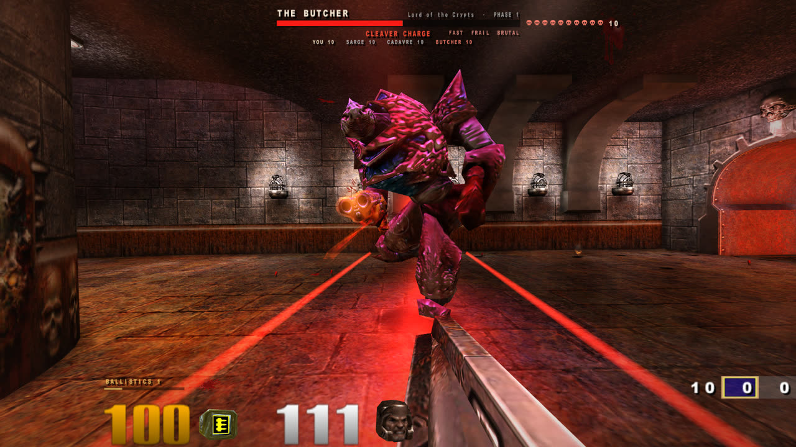
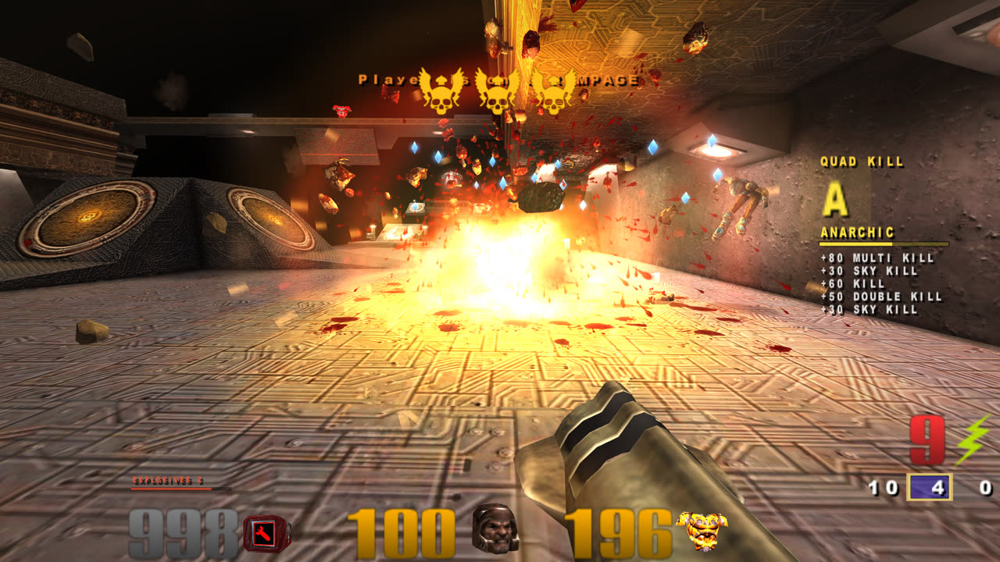
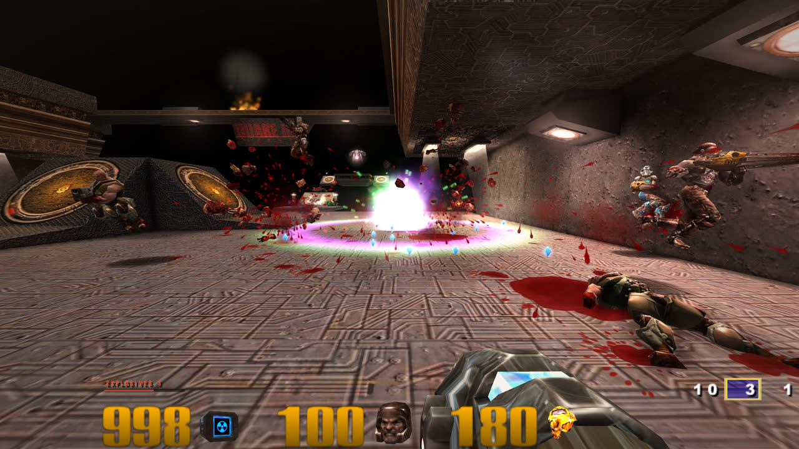
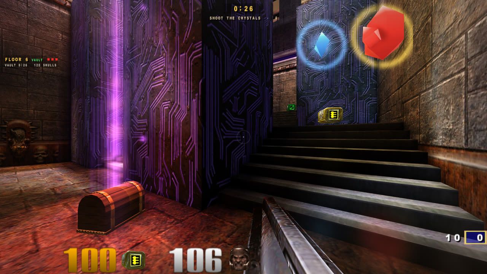

# REARMED

**Every gun gets a second trigger.** REARMED is a free mod for Quake III Arena, built on ioquake3. It adds
alt-fire to every weapon, modern movement, smarter bots, gore and physics, and **DESCENT**: a roguelike run
through four acts of floors with bosses, loot and weapon evolutions.

**[Download on Nexus Mods](https://www.nexusmods.com/quake3arena/mods/11)** · Windows · free · beta

## What's in it

- **Alt-fire on every gun.** Sticky grenades, rockets you detonate mid-flight, chain lightning, ricochet
  rails, a plasma whirlpool, a triple BFG.
- **Movement.** Double jump, wall jump, wall run, dash, slide, ground pound, an offhand grapple and a zip line.
- **Bots that keep up.** They flank, dodge rockets and rails, rocket-jump, time the big items and hunt you
  by sound.
- **Hit feel.** Headshots, dismemberment, wall splats, physics props, a kill cam and a style meter.
- **Game modes.** Normal, Gun Game, Juggernaut, Instagib, One in the Chamber, and 1v1 over the network.
- **Widescreen done right.** Hor+ field of view and a HUD that fits ultrawide screens.

## DESCENT

A run of 24 floors in four acts, each act ending in a boss: The Butcher, The Overseer, The Hollow King and
The Arch-Demon. Win a floor and pick a card; level your weapons until they evolve; open chests; find
secret stashes and vaults; unlock characters and skills that carry over between runs. Enemies come in
nine types with elite affixes, and a nemesis levels up every time it kills you. There's a Daily Challenge
with the same run for everyone that day.

| | |
|---|---|
|  |  |
| A rocket turns four bots into gems | Evolved weapons: the black hole |
|  | |
| A secret vault: shoot the crystals | |

## Play it

You need your own **Quake III Arena** (Steam or GOG) on Windows 10 or 11. REARMED ships no id Software
files; it reads the game data from your install and never changes it. Team Arena, which comes with both
versions, adds the nailgun, chaingun and prox launcher.

1. Download the zip from [Nexus Mods](https://www.nexusmods.com/quake3arena/mods/11) and unzip it anywhere.
2. Run **Play REARMED.bat**. The first start finds your Quake III install by itself.
3. Press **F10** in game for the settings. Every feature has its own switch, gore included.

DESCENT is in the main menu.

| New controls | |
|---|---|
| Right mouse | Alt-fire (hold to charge) |
| Q or Shift | Dash |
| E (hold) | Offhand grapple |
| Z | Zip line (aim at a wall) |
| C | Slide while running, ground pound in the air |
| R (hold) | Weapon wheel |
| F / G / V | Nailgun / prox launcher / chaingun |

## Help and bugs

- Something broken? Post in the **Bugs** tab on the [Nexus page](https://www.nexusmods.com/quake3arena/mods/11)
  and attach `home\rearmed\games.log` and `home\rearmed\qconsole.log` from the REARMED folder.
  `TESTERS.txt` in the download says what helps most.
- Using an AI agent like Claude Code or Codex on your PC? Point it at
  [AGENTS.md](release_files/AGENTS.md) (it ships in the download too): it lists what is safe to touch and
  how to fix the common problems.

## More

- **[Every feature in detail](docs/REFERENCE.md):** the full reference, with every setting and console
  variable.
- **[Changelog](CHANGELOG.md)**
- **[Building from source](BUILDING.md)**

## Support

REARMED is free and stays free. If you enjoy it, an endorsement on Nexus helps, and there's a
[tip jar on Gumroad](https://xt3.gumroad.com/l/rearmed).

## License

GPL v2, like the Quake III Arena source release and ioquake3 ([LICENSE](LICENSE)). REARMED is a fan project,
not made or supported by id Software, ZeniMax or Bethesda. Quake is their trademark.
